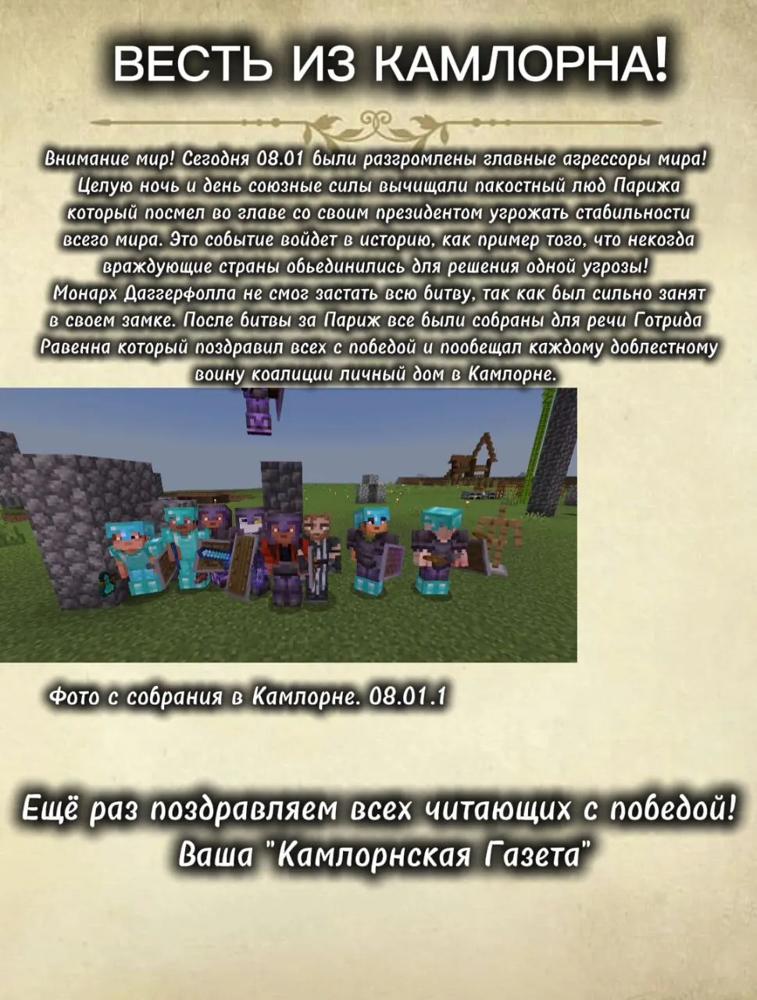
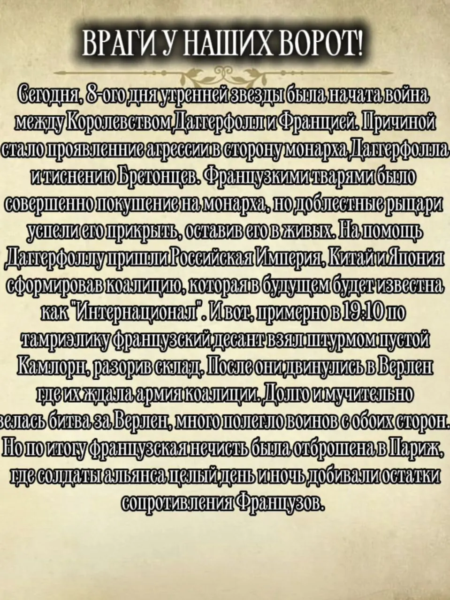

# Газета:12 сезон Minecampff

В хрониках Камлорна зафиксировано событие, произошедшее в тот период, когда Даггерфолл оказался на грани нового кризиса: французские войска, возглавляемые влиятельным агрессором,пытались подорвать устойчивость региона. По словам источников, глава коалиции и монарх Даггерфолла мобилизовали союзников и выдвинули демонстративное предупреждение Франции, чтобы предотвратить эскалацию конфликта. В усилиях по координации дипломатии особую роль сыграл Готрид Равенн — один из ведущих советников и дипломатов, чьи контакты в столицах соседних земель помогали сглаживать острые углы дипломатических кризисов. Объединённые державы, осознавая угрозу для общей стабильности, собрали свои силы и провозгласили коллективную защиту, тем самым продемонстрировав волю к миру и готовность к совместным действиям. В результате решительного сопротивления и дипломатических мер камлорнские войска сумели задержать агрессора и отстоять позиции в Битве при Верлене (08.01.1), что закрепило временную победу и повысило доверие к правительству внутри страны. Фотография собрания в Камлорне (08.01.1) служит архивным свидетельством того часа, когда народ и правители объединились ради сохранения целостности и перспектив будущего, а праздник победы стал символом единства против общих угроз.

<figure><figcaption></figcaption></figure>

\--------------------------------------------------------------------------------------------------------

Восьмого дня месяца Утренней звезды началась война между Королевством Даггерфолл и Францией. Причиной конфликта стали агрессивные действия Франции, направленные против монарха Даггерфолла и бретонских земель. Ситуация обострилась после покушения, совершённого французскими агентами на короля Даггерфолла, которое было предотвращено лишь благодаря самопожертвованию его верных рыцарей. В ответ на эту неспровоцированную агрессию была сформирована мощная коалиция, получившая название «Интернационал». На помощь Даггерфоллу пришла Российская Империя, Китай и Япония, что придало конфликту поистине интернациональный характер.\
‎\
‎Центральным событием войны стала масштабная и ожесточённая битва за город Верлен. Несмотря на яростные атаки, французским войскам не удалось взять Верлен. Напротив, объединённые силы коалиции не только выстояли в обороне, но и организовали успешное контрнаступление, в результате которого выбили французские войска с территории самого Даггерфолла.\
‎\
‎Одержав победу, войска «Интернационала» перешли в решительное наступление и двинулись на Париж. Кульминацией войны стал штурм французской столицы, где в течение целых суток — дня и ночи — шли уличные бои с ожесточённо сопротивлявшимися силами французских анархистов, составлявших ядро обороны города. Эта битва окончательно сломила сопротивление Франции.\
‎\
‎Война, начавшаяся с вероломного нападения, завершилась полной победой коалиции «Интернационал» ненадолго изменив баланс сил в мире, покончив с периодом французской гегемонии и внутренней смуты и дав передышку для новой войны.

<figure><figcaption></figcaption></figure>
